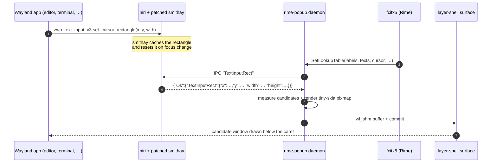

# TextInputRect: caret IPC for input-method candidate windows

**English** | [简体中文](text-input-rect.zh-CN.md)

This fork adds one IPC request to niri: `TextInputRect`. It returns the
focused text input's caret rectangle in output-logical coordinates, so an
external input-method UI (such as
[rime-popup](https://github.com/yekeno/rime-popup)) can draw its candidate
window under the caret on Wayland.

The patch touches three layers:

| Layer | Change |
| --- | --- |
| [smithay](https://github.com/yekeno/smithay/tree/niri-text-input-rect) | expose the cached `zwp_text_input_v3` cursor rectangle and reset it on focus change |
| `niri-ipc` | add `Request::TextInputRect`, `Response::TextInputRect`, and the `TextInputRect` struct |
| `src/ipc/server.rs` | answer the request on the compositor's event loop and convert surface-local coordinates to output-logical coordinates |

## Why stock niri cannot do this

A Wayland client sends its caret position with
`zwp_text_input_v3.set_cursor_rectangle` to the **compositor**, not to the
input method. fcitx5 therefore has no caret for Wayland clients: its kimpanel
`SetSpotRect` is empty, and its classic UI relies on the input-method popup
surface that the compositor itself places.

Stock niri (via smithay) already stores that rectangle internally to position
input-method popup surfaces, but it never exposes the value to other
processes and it does not reset it when keyboard focus changes. This fork
adds the missing accessor, the reset, and an IPC request.

X11/XIM clients are unaffected: they have no text-input rectangle, so
rime-popup falls back to kimpanel's `SetSpotRect` for them.

## Data flow



The IPC request is a single JSON line. niri serialises its `Request` enum as
the bare variant name:

```text
→ "TextInputRect"
← {"Ok":{"TextInputRect":{"x":812,"y":244,"width":2,"height":18}}}
```

`null` means no focused text input has reported a rectangle yet. The daemon
then hides its popup rather than drawing at the output origin.

Try it by hand:

```bash
printf '"TextInputRect"\n' | socat - "UNIX-CONNECT:$NIRI_SOCKET"
```

## Coordinate conversion

The client rectangle is in the focused surface's local coordinates. The IPC
handler adds the window's render position on its output:

```text
output_logical = window_render_position + surface_local_rect
```

The position comes from `tiles_with_render_positions()`, so tiled, floating and
scrolling layouts are all handled. The result is rounded to logical pixels.

## Process design

1. Keyboard focus moves to a surface. smithay clears the cached rectangle so
   the previous client's caret cannot be reused.
2. The client commits `set_cursor_rectangle`; smithay caches it.
3. fcitx5 pushes a new candidate list to rime-popup over kimpanel.
4. rime-popup asks niri for the rectangle (it also refreshes it when the
   candidate list changes, because a window may move without a new caret).
5. niri hops onto its own event loop (`insert_idle`) to read compositor state
   safely, converts coordinates, and replies.
6. rime-popup positions its layer-shell surface at
   `(caret.x, caret.y + caret.height + vertical_offset)` and uploads a frame.

## Tested local environment

| Component | Value |
| --- | --- |
| OS | Ubuntu 22.04.5 LTS (jammy), x86_64 |
| Kernel | 6.8.0-138-generic |
| libc | glibc 2.35 |
| Session | Wayland (`XDG_SESSION_TYPE=wayland`, `XDG_CURRENT_DESKTOP=niri`) |
| Rust | rustc / cargo 1.93.1 (rustup) |
| niri | 26.04 (`v26.04-192-g4263c9a1` + this patch) |
| smithay | 0.7.0 at `9786228` + cursor-rectangle accessor |
| libinput | **1.25.0 built from source** (Ubuntu 22.04 ships 1.20, too old) |
| libwayland | 1.24.0 (`savoury1/display` PPA) |
| libdisplay-info | 0.2.0 (`savoury1/display` PPA) |
| Fonts | Noto Sans CJK (`fonts-noto-cjk`) |

## Building this fork on Ubuntu 22.04

The tested environment is listed above. The two Ubuntu 22.04 gotchas are
`libdisplay-info` (not packaged) and **libinput**: niri's `input` crate is
built with the `libinput_1_21` feature and calls
`libinput_device_config_dwtp_set_enabled`, which Ubuntu 22.04's libinput 1.20
does not export. Building libinput 1.25 from source into a private prefix
avoids replacing the system input stack.

Install the niri build dependencies:

```bash
sudo apt update
sudo apt install -y build-essential pkg-config clang \
    libudev-dev libgbm-dev libxkbcommon-dev libegl1-mesa-dev \
    libwayland-dev libinput-dev libsystemd-dev libdbus-1-dev \
    libseat-dev libpipewire-0.3-dev libpango1.0-dev \
    meson ninja-build libevdev-dev libmtdev-dev libwacom-dev
```

Ubuntu 22.04 does not ship `libdisplay-info-dev`; this machine gets it (and a
newer `libwayland-dev`) from the `savoury1/display` PPA:

```bash
sudo add-apt-repository ppa:savoury1/display
sudo apt update
sudo apt install -y libdisplay-info-dev libwayland-dev
```

Build libinput 1.25.0 into `/opt/libinput-1.25` (the development machine uses
`/srv/tools/wm/build/libinput-prefix`):

```bash
git clone --branch 1.25.0 --depth 1 \
    https://gitlab.freedesktop.org/libinput/libinput.git
cd libinput
meson setup build --prefix=/opt/libinput-1.25 --libdir=lib/x86_64-linux-gnu
ninja -C build
sudo ninja -C build install
```

Expose that prefix to pkg-config and to the linker. The rpath makes the
installed binary find the private libinput at runtime:

```bash
export LIBINPUT_PREFIX=/opt/libinput-1.25
export PKG_CONFIG_PATH=$LIBINPUT_PREFIX/lib/x86_64-linux-gnu/pkgconfig
export RUSTFLAGS="-L native=$LIBINPUT_PREFIX/lib/x86_64-linux-gnu -C link-arg=-Wl,-rpath,$LIBINPUT_PREFIX/lib/x86_64-linux-gnu"
```

Install Rust and build:

```bash
curl --proto '=https' --tlsv1.2 -sSf https://sh.rustup.rs | sh
source "$HOME/.cargo/env"

git clone https://github.com/yekeno/niri.git
cd niri
cargo build --release
sudo install -m755 target/release/niri /usr/local/bin/niri
```

The repository's `[patch]` section points `smithay` at
`yekeno/smithay` rev `d0905a9`, which carries the cursor-rectangle accessor.
No manual patch is needed.

Log out and back in (or restart niri) so the new compositor binary is used.

## Using it with rime-popup

Run [rime-popup](https://github.com/yekeno/rime-popup). It probes for
`TextInputRect` at startup; if niri answers, it owns `org.kde.impanel` and
fcitx5 switches to the numbered candidate window drawn by rime-popup. If the
request is unsupported, rime-popup deliberately leaves fcitx5 on its own UI.

## Limitations

- The rectangle is only available for Wayland clients using
  `zwp_text_input_v3`. X11/XIM clients still fall back to kimpanel's spot rect.
- Focus changes clear the rectangle, so a popup cannot be positioned until the
  new client reports one.
- The request is not upstream. Use this fork until an equivalent API lands in
  niri/smithay.
