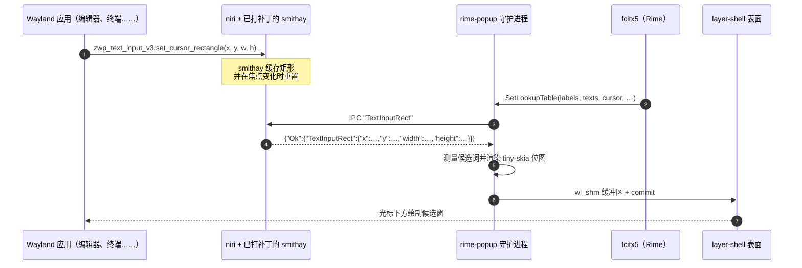

# TextInputRect：输入法候选窗的光标 IPC

[English](text-input-rect.md) | **简体中文**

本分支为 niri 增加了一个 IPC 请求：`TextInputRect`。它以输出逻辑坐标返回
当前焦点文本输入的光标矩形，使外部输入法 UI（例如
[rime-popup](https://github.com/yekeno/rime-popup)）能在 Wayland 上把候选窗
绘制在光标下方。

补丁涉及三层：

| 层 | 改动 |
| --- | --- |
| [smithay](https://github.com/yekeno/smithay/tree/niri-text-input-rect) | 暴露缓存的 `zwp_text_input_v3` 光标矩形，并在焦点变化时重置 |
| `niri-ipc` | 增加 `Request::TextInputRect`、`Response::TextInputRect` 和 `TextInputRect` 结构体 |
| `src/ipc/server.rs` | 在合成器事件循环中处理请求，并把表面局部坐标转换为输出逻辑坐标 |

## 为什么原生 niri 做不到

Wayland 客户端通过 `zwp_text_input_v3.set_cursor_rectangle` 把光标位置发给
**合成器**，而不是输入法。因此对 Wayland 客户端，fcitx5 拿不到光标：它的
kimpanel `SetSpotRect` 是空的，经典 UI 只能依赖合成器摆放的 input-method
弹窗表面。

原生 niri（通过 smithay）内部已经保存了这个矩形，用来定位 input-method 弹窗
表面，但从未把该值暴露给其他进程，也不会在键盘焦点变化时重置。本分支补上了
访问器、重置逻辑和 IPC 请求。

X11/XIM 客户端不受影响：它们没有文本输入矩形，因此 rime-popup 会回退到
kimpanel 的 `SetSpotRect`。

## 数据流



IPC 请求是一行 JSON。niri 把它的 `Request` 枚举序列化为裸变体名：

```text
→ "TextInputRect"
← {"Ok":{"TextInputRect":{"x":812,"y":244,"width":2,"height":18}}}
```

`null` 表示当前没有焦点文本输入报告过矩形。此时守护进程会隐藏弹窗，而不是
画在输出原点。

可以手动测试：

```bash
printf '"TextInputRect"\n' | socat - "UNIX-CONNECT:$NIRI_SOCKET"
```

## 坐标转换

客户端矩形位于焦点表面的局部坐标。IPC 处理器会加上窗口在其输出上的渲染位置：

```text
output_logical = window_render_position + surface_local_rect
```

位置来自 `tiles_with_render_positions()`，因此平铺、浮动和滚动布局都能处理。
结果会四舍五入到逻辑像素。

## 进程设计

1. 键盘焦点移到某个表面。smithay 清除缓存矩形，避免复用上一个客户端的光标。
2. 客户端提交 `set_cursor_rectangle`；smithay 缓存它。
3. fcitx5 通过 kimpanel 向 rime-popup 推送新的候选词列表。
4. rime-popup 向 niri 请求矩形（候选词列表变化时也会刷新，因为窗口可能在
   没有新光标的情况下移动）。
5. niri 跳回自己的事件循环（`insert_idle`）以安全读取合成器状态，转换坐标
   并回复。
6. rime-popup 把 layer-shell 表面定位到
   `(caret.x, caret.y + caret.height + vertical_offset)` 并上传一帧。

## 验证环境

| 组件 | 值 |
| --- | --- |
| OS | Ubuntu 22.04.5 LTS (jammy), x86_64 |
| 内核 | 6.8.0-138-generic |
| libc | glibc 2.35 |
| 会话 | Wayland（`XDG_SESSION_TYPE=wayland`，`XDG_CURRENT_DESKTOP=niri`） |
| Rust | rustc / cargo 1.93.1（rustup） |
| niri | 26.04（`v26.04-192-g4263c9a1` + 本补丁） |
| smithay | `9786228` 的 0.7.0 + 光标矩形访问器 |
| libinput | **源码构建的 1.25.0**（Ubuntu 22.04 自带 1.20，太旧） |
| libwayland | 1.24.0（`savoury1/display` PPA） |
| libdisplay-info | 0.2.0（`savoury1/display` PPA） |
| 字体 | Noto Sans CJK（`fonts-noto-cjk`） |

## 在 Ubuntu 22.04 上构建本分支

验证环境见上表。Ubuntu 22.04 有两个坑：`libdisplay-info`（未打包）和
**libinput**——niri 的 `input` crate 使用 `libinput_1_21` 特性构建，会调用
`libinput_device_config_dwtp_set_enabled`，而 Ubuntu 22.04 的 libinput 1.20
没有导出该符号。把 libinput 1.25 从源码安装到私有前缀，可以避免替换系统输入
栈。

安装 niri 构建依赖：

```bash
sudo apt update
sudo apt install -y build-essential pkg-config clang \
    libudev-dev libgbm-dev libxkbcommon-dev libegl1-mesa-dev \
    libwayland-dev libinput-dev libsystemd-dev libdbus-1-dev \
    libseat-dev libpipewire-0.3-dev libpango1.0-dev \
    meson ninja-build libevdev-dev libmtdev-dev libwacom-dev
```

Ubuntu 22.04 没有 `libdisplay-info-dev`；验证机器从 `savoury1/display` PPA
安装它（以及更新的 `libwayland-dev`）：

```bash
sudo add-apt-repository ppa:savoury1/display
sudo apt update
sudo apt install -y libdisplay-info-dev libwayland-dev
```

把 libinput 1.25.0 构建到 `/opt/libinput-1.25`（开发机器使用
`/srv/tools/wm/build/libinput-prefix`）：

```bash
git clone --branch 1.25.0 --depth 1 \
    https://gitlab.freedesktop.org/libinput/libinput.git
cd libinput
meson setup build --prefix=/opt/libinput-1.25 --libdir=lib/x86_64-linux-gnu
ninja -C build
sudo ninja -C build install
```

让 pkg-config 和链接器找到该前缀。rpath 使安装后的二进制在运行时找到私有
libinput：

```bash
export LIBINPUT_PREFIX=/opt/libinput-1.25
export PKG_CONFIG_PATH=$LIBINPUT_PREFIX/lib/x86_64-linux-gnu/pkgconfig
export RUSTFLAGS="-L native=$LIBINPUT_PREFIX/lib/x86_64-linux-gnu -C link-arg=-Wl,-rpath,$LIBINPUT_PREFIX/lib/x86_64-linux-gnu"
```

安装 Rust 并构建：

```bash
curl --proto '=https' --tlsv1.2 -sSf https://sh.rustup.rs | sh
source "$HOME/.cargo/env"

git clone https://github.com/yekeno/niri.git
cd niri
cargo build --release
sudo install -m755 target/release/niri /usr/local/bin/niri
```

仓库的 `[patch]` 段把 `smithay` 指向 `yekeno/smithay` 的 rev `d0905a9`，
其中包含光标矩形访问器。无需手动打补丁。

注销并重新登录（或重启 niri），以使用新的合成器二进制。

## 与 rime-popup 配合使用

运行 [rime-popup](https://github.com/yekeno/rime-popup)。它会在启动时探测
`TextInputRect`；如果 niri 响应，它就会占用 `org.kde.impanel`，fcitx5 切换到
由 rime-popup 绘制的带序号候选窗。如果请求不受支持，rime-popup 会刻意让
fcitx5 保持自己的 UI。

## 限制

- 该矩形仅适用于使用 `zwp_text_input_v3` 的 Wayland 客户端。X11/XIM 客户端
  仍然回退到 kimpanel 的 spot rect。
- 焦点变化会清除矩形，因此在新客户端报告矩形之前，弹窗无法定位。
- 该请求尚未上游。在 niri/smithay 合入等价 API 之前，请使用本分支。
